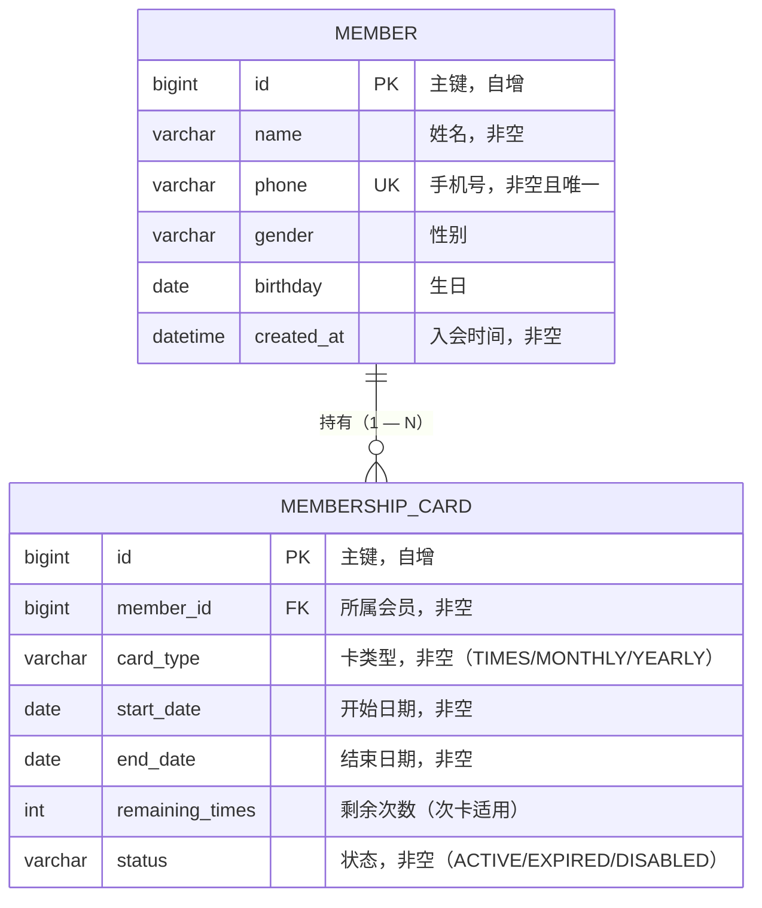

# 数据库设计（第 04 周）

## 概述

系统使用 MySQL 8.x 作为生产/运行数据库（测试时使用 H2 内存数据库），通过 Spring Data JPA 进行持久化，由 Hibernate 根据实体自动建表（`ddl-auto: update`）。共两张业务表：`member`（会员）与 `membership_card`（会员卡）。

## ER 关系

## 表结构明细

### 表 1：`member`（会员表）

| 字段 | 类型 | 约束 | 说明 |
| --- | --- | --- | --- |
| `id` | BIGINT | **主键**，自增 | 会员 ID |
| `name` | VARCHAR(50) | NOT NULL | 姓名 |
| `phone` | VARCHAR(20) | NOT NULL，**UNIQUE** | 手机号，业务规则：全局唯一 |
| `gender` | VARCHAR(10) | 可空 | 性别 |
| `birthday` | DATE | 可空 | 生日 |
| `created_at` | DATETIME | NOT NULL，不可更新 | 入会时间（`@PrePersist` 自动记录） |

### 表 2：`membership_card`（会员卡表）

| 字段 | 类型 | 约束 | 说明 |
| --- | --- | --- | --- |
| `id` | BIGINT | **主键**，自增 | 会员卡 ID |
| `member_id` | BIGINT | NOT NULL，**外键 → member.id** | 所属会员 |
| `card_type` | VARCHAR(20) | NOT NULL | 卡类型枚举：TIMES（次卡）/ MONTHLY（月卡）/ YEARLY（年卡） |
| `start_date` | DATE | NOT NULL | 有效期开始日期 |
| `end_date` | DATE | NOT NULL | 有效期结束日期，业务规则：必须晚于 `start_date` |
| `remaining_times` | INT | 可空 | 剩余次数，业务规则：次卡必须 > 0 |
| `status` | VARCHAR(20) | NOT NULL，默认 ACTIVE | 状态枚举：ACTIVE / EXPIRED / DISABLED |

## 必要约束与业务规则对应

1. **唯一约束**：`member.phone` 唯一索引 —— 对应 Service 规则"同一手机号只能注册一个会员"（违反时由 Service 先检查并返回 409）。
2. **外键约束**：`membership_card.member_id → member.id`（非空）—— 每张卡必须归属已存在的会员（会员不存在时 Service 返回 404）。
3. **非空约束**：卡类型、有效期、状态等关键字段均 NOT NULL。
4. **应用层校验**（Service 中实现，数据库无法表达的规则）：
   - `end_date > start_date`（有效期合法）
   - 次卡（TIMES）必须 `remaining_times > 0`

## 数据访问与测试数据

- 数据访问代码位于 `monolith/src/main/java/com/zjgsu/yz/gym/repository/`（`MemberRepository`、`MembershipCardRepository`，均继承 `JpaRepository`）。
- API 输入通过 DTO 承载（`web/dto/` 包下的 `CreateMemberRequest`、`CreateCardRequest`），不直接暴露实体。
- 测试环境使用 `src/test/resources/application.yml` 配置的 H2 内存库 + `src/test/resources/data.sql` 种子数据，每次 `./mvnw test` 自动建表、灌入数据、测试结束后清理，可重复执行。
