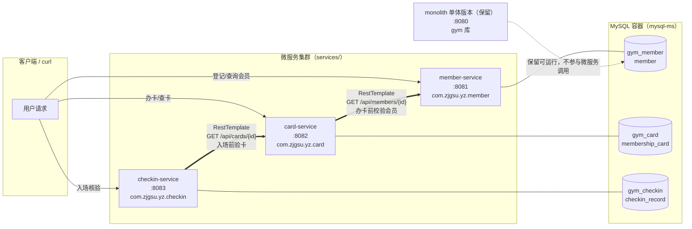

# 微服务拆分设计（第 06 周）

将单体应用 `monolith/`（椰汁健身房会员管理系统）拆分为 3 个微服务。单体代码保留在 `monolith/` 目录不覆盖；拆分后的服务位于仓库根目录 `services/` 下，每个服务都是独立的 Spring Boot 工程（独立 `pom.xml` + `src/`）。

## 一、单体模块到微服务的拆分映射

| 单体中的模块 | 拆分去向 | 说明 |
| --- | --- | --- |
| `model/Member`、`MemberRepository`、会员登记/查询接口 | `services/member-service` | 会员档案成为独立服务，独享 member 库 |
| `model/MembershipCard`、`MembershipCardRepository`、办卡接口 | `services/card-service` | 会员卡成为独立服务，独享 card 库；办卡时通过 HTTP 调用 member-service 校验会员 |
| （单体中隐含的"入场核验"场景） | `services/checkin-service` | 新增入场核验服务：核验前通过 HTTP 调用 card-service 验卡，有效才写入入场记录 |
| `PingController`、业务规则校验 | 保留在 monolith；校验规则按归属拆入各服务 | 单体版本保留可运行 |

## 二、服务清单（职责 / 端口 / 数据库 / 数据表）

| 服务 | 端口 | 职责 | 独立数据库 | 拥有的数据表 | 基础包 |
| --- | --- | --- | --- | --- | --- |
| member-service | 8081 | 会员档案管理：登记（手机号唯一）、查询会员 | `gym_member`（账号 `member_u`） | `member` | `com.zjgsu.yz.member` |
| card-service | 8082 | 会员卡管理：办卡（有效期/次卡规则校验）、查卡；办卡前调用 member-service 确认会员存在 | `gym_card`（账号 `card_u`） | `membership_card` | `com.zjgsu.yz.card` |
| checkin-service | 8083 | 入场核验：校验会员卡有效（属于该会员、状态 ACTIVE、未过期）后记录入场 | `gym_checkin`（账号 `checkin_u`） | `checkin_record` | `com.zjgsu.yz.checkin` |
| monolith（单体版本，保留） | 8080 | 原单体应用（member + card） | `gym` | `member`、`membership_card` | `com.zjgsu.yz.gym` |

每个服务提供健康接口 `GET /actuator/health`（Spring Boot Actuator，健康检查包含数据库状态）。

## 三、服务之间的调用关系

```
checkin-service ──HTTP──▶ card-service ──HTTP──▶ member-service
（入场核验）    GET /api/cards/{id}   （办卡）   GET /api/members/{id}
```

- **card-service → member-service**：办卡前用 `RestTemplate` 调用 `GET /api/members/{memberId}` 确认会员存在；会员不存在 → 404；member-service 不可达/超时 → 503，**不写入本地数据**。
- **checkin-service → card-service**：入场前调用 `GET /api/cards/{cardId}` 验卡（卡必须属于该会员、状态 ACTIVE、未过期）；任何校验不通过 → 明确错误，**不写入入场记录**；card-service 不可达/超时 → 503。

跨服务调用配置：被调服务地址写在各服务 `application.yml`（`member-service.base-url` / `card-service.base-url`），可用环境变量 `MEMBER_SERVICE_BASEURL` / `CARD_SERVICE_BASEURL` 覆盖（Compose 中配置为服务名地址）；`RestTemplate` 配置了连接超时 2s、读取超时 3s。

## 四、服务边界与数据所有权规则

1. **每个服务只读写自己的数据库**：member-service 只碰 `gym_member.member`，card-service 只碰 `gym_card.membership_card`，checkin-service 只碰 `gym_checkin.checkin_record`。
2. **跨服务关联只保存对方 ID**：`membership_card.member_id`、`checkin_record.member_id/card_id` 都是普通列 + 普通索引，**不建立跨库外键**，也不持有对方实体对象。
3. **不直接调用对方的 Repository**：跨服务信息获取一律通过对方 HTTP API。
4. **数据库账号隔离**：`member_u`/`card_u`/`checkin_u` 分别只能访问各自的库（MySQL GRANT 授权），从数据库层面强制边界。
5. **失败处理**：依赖服务不可用或超时 → 返回 503（`SERVICE_UNAVAILABLE`），明确报错，不静默降级、不跳过校验写本地数据。

## 五、Mermaid 架构图



## 六、"远端成功、本地失败"窗口说明

以入场核验为例：checkin-service 调用 card-service 验卡成功（远端成功）之后、本地 `checkin_record` 落库之前，如果本地数据库故障，会出现**卡已被"消费核验"但本地没有入场记录**的窗口——远端状态与本地状态短暂不一致。本周按作业要求只做顺序流程与基本失败处理（明确报错、不写脏数据），不实现跨服务原子事务、自动补偿或消息机制；该窗口的消除（如本地事务 + 事后对账 / 消息队列）留待后续演进。

---

## 第 07 周补充：Nacos 服务注册与发现

- 注册中心：Nacos Server v3.2.4（compose.yaml 中 `nacos` 服务，控制台 18080、服务端 8848、SDK gRPC 9848，独立数据卷持久化）
- 服务名保持不变：`member-service` / `card-service` / `checkin-service`（即各自 `spring.application.name`），与本文档上方拆分映射一致；同一业务服务的多实例使用相同服务名
- 分组：`GYM_YZ_GROUP`（个人项目独立分组，与课堂示例隔离）；命名空间使用默认 public
- 依赖版本：Spring Cloud Alibaba 2025.1.0.0 BOM（适配 Spring Boot 4.0.x），仅引入 Discovery Starter，不引入 Config Starter
- 调用方式变化：card-service → member-service、checkin-service → card-service 均改为每次操作前 `DiscoveryClient.getInstances("服务名")` 解析实例，使用实例 URI + 原业务路径发起 HTTP 请求；不再保存固定地址（`member-service.base-url` / `CARD_SERVICE_BASE_URL` 配置已删除）
- 失败处理：实例列表为空 → 503（RemoteServiceException）；HTTP 404 → 原 404 业务响应；调用失败/超时 → 503，不跳过校验、不写本地数据
